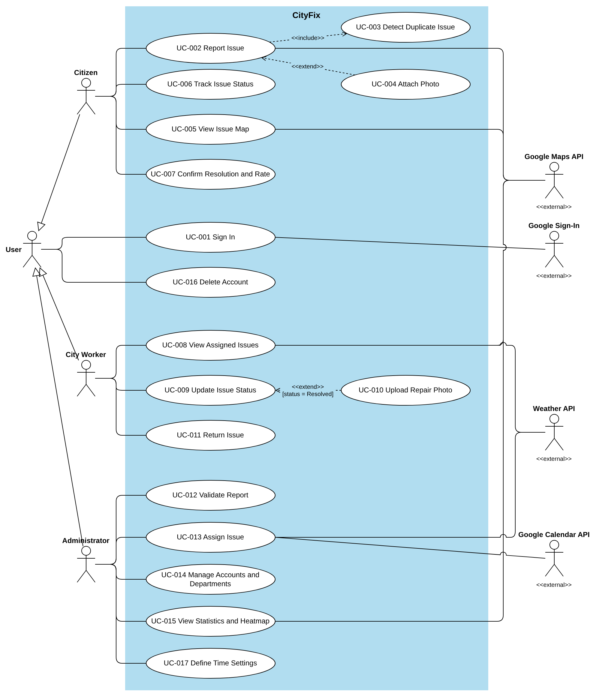

# 3. Use Cases

**Objective:** Show the principal interactions between the application's actors and the system. Describe how an actor achieves a goal and what happens when an important step fails. Base the interactions on the approved requirements and revise them as the application develops.

## 3.1 Use Case Diagram

**Objective:** Show the system boundary, its relevant actors, and their main goals in **one readable UML use case diagram**. Add a focused second diagram only if the complete view cannot remain clear. A third requires a distinct project-specific reason.

**Rendered use case diagram:**  
  
**Versioned source (draw.io):** [use_case_diagram.drawio.svg](./assets/use_case_diagram.drawio.svg)

**Reading the diagram:** The three primary actors are the roles from §2.3. They are specialisations of a general User actor, so the use cases every signed-in user can perform (UC-001 Sign In and UC-016 Delete Account) are connected once, to User. Google Sign-In, Google Maps, the weather API and Google Calendar are external systems that CityFix uses. Duplicate detection (UC-003) is always performed when a report is submitted, so it is an `<<include>>` of UC-002. Attaching a photo (UC-004) is optional and therefore an `<<extend>>` of UC-002. Uploading a repair photo (UC-010) extends UC-009 when the new status is "Resolved".

---

## 3.2 Use Case Descriptions

**Objective:** For each use case in the diagram, explain the actor's goal, the normal interaction with the application, and meaningful alternatives. Describe straightforward use cases briefly. Expand those whose alternatives, external dependencies, or consequences require more explanation.

### UC-001: Sign-In

| Field | Description |
| --- | --- |
| Primary actor | Citizen, City Worker, Administrator |
| Requirement ID(s) | F-001, F-002 |
| Preconditions, if any | For a City Worker or Administrator the account must be created first by an Administrator with the user's email (UC-014)|
| Main flow | 1. The user chooses to sign in. The application redirects to the identity provider. 2. The user authenticates with their Google account. 3. The application receives the user's email address and looks for an account with that email. 4. If no account exists, the application creates a Citizen account linked to that email. If an account created by an Administrator exists, the application uses its role and department. 5. The application opens the interface for the user's role. |
| Alternative or failure flows, if any | **2a — Sign-in cancelled or rejected:** the application returns to the sign-in page, explains that sign-in did not complete and keeps the restricted actions unavailable. **3a — Identity provider unavailable:** the application reports that sign-in is temporarily unavailable and creates no session. **4a — Account deactivated by an Administrator:** the user is signed in but every protected page denies access (F-020, NF-06). |
| Result | The user is signed in and sees the functions of their role. No password is stored by the system. |

### UC-002: Report Issue

| Field | Description |
| --- | --- |
| Primary actor | Citizen |
| Requirement ID(s) | F-003, F-004 |
| Preconditions, if any | The citizen is signed in. |
| Main flow | 1. The citizen opens the report form. The application shows the fields for category, description, photos and location. 2. The citizen selects a category and writes a description of the problem. 3. The citizen specifies the location by using their current location, typing an address with suggestions, or placing a pin on the map. The pin can be dragged to adjust it. The application shows the address of the chosen point for confirmation. 4. The citizen may add photos (UC-004). 5. The citizen submits the report. The application checks the required data and looks for a possible duplicate (UC-003). 6. If there is no duplicate, the application saves the report with the status "Reported" and shows a confirmation. |
| Alternative or failure flows, if any | **3a — Geolocation permission denied or not supported by the browser:** the application says so, and the citizen types an address or places a pin on the map. The flow continues at step 4 (NF-10). **3b — Address lookup unavailable:** the application shows an error message, keeps the entered data and the pin, and the citizen can still submit the report (NF-09). **3c — Typed address not found:** the application asks the citizen to try another spelling or place a pin on the map. **5a — Required data missing (category, description or location):** the application indicates what is missing, keeps the entered data and the chosen location, and does not save the report. **5b — Possible duplicate found:** the flow continues in UC-003. **6a — Saving fails:** the application states that the report was not submitted and does not show a confirmation. |
| Result | The report is saved with the status "Reported". |

### UC-003: Detect Duplicate Issue

| Field | Description |
| --- | --- |
| Primary actor | Citizen |
| Requirement ID(s) | F-005 |
| Preconditions, if any | The citizen has submitted a report (UC-002, step 5). |
| Main flow | 1. The application looks for an unresolved report of the same category within 50 m of the chosen location. 2. If one exists, the application shows it to the citizen. 3. The citizen chooses to support the existing report instead of creating a new one. The application increases the existing report's priority and shows a confirmation. |
| Alternative or failure flows, if any | **1a — No similar report found:** UC-002 continues at step 6. **3a — The citizen decides it is a different problem:** the application saves the new report as in UC-002, step 6. |
| Result | A duplicate is avoided, or the new report proceeds. |

### UC-004: Attach Photo

| Field | Description |
| --- | --- |
| Primary actor | Citizen |
| Requirement ID(s) | F-003 |
| Preconditions, if any | The citizen is filling in the report form. |
| Main flow | 1. The citizen chooses to add a photo, taking one with the device camera or selecting one. 2. The application shows a preview of the photo in the form. 3. The photo is uploaded when the report is submitted (UC-002, step 5). |
| Alternative or failure flows, if any | **3a — Upload fails or the file is not accepted:** the application explains the problem. The citizen may retry or submit the report without the photo. |
| Result | The photo is attached to the report. |

### UC-005: View Issue Map

| Field | Description |
| --- | --- |
| Primary actor | Citizen |
| Requirement ID(s) | F-006 |
| Preconditions, if any | None. The public map is available without signing in (NF-07). |
| Main flow | 1. The citizen opens the map. The application shows the public reports as markers and groups nearby markers when there are many in a small area. 2. The citizen filters by category, status or a date range (from–to), and the application updates the map and the number of shown reports. The citizen can reset the filters. 3. The citizen selects a marker to see the details of that report. |
| Alternative or failure flows, if any | **1a — Map cannot be loaded:** the application shows an error message and lets the citizen retry. **2a — No report matches the filters:** the application shows a message suggesting to change or reset the filters. |
| Result | The citizen sees the reports that match the chosen filters. |

### UC-006: Track Issue Status

| Field | Description |
| --- | --- |
| Primary actor | Citizen |
| Requirement ID(s) | F-007, F-008, F-013 |
| Preconditions, if any | The citizen is signed in and has submitted at least one report. |
| Main flow | 1. The citizen opens "My reports". The application lists their reports with the category, address, date and current status of each. 2. The citizen selects a report and the application shows its details and history. When the issue is resolved, the "after" photo uploaded by the worker is also shown. 3. When the status of a report changes, the application creates an in-app notification for the citizen, and the number of unread notifications is shown in the navigation bar. |
| Alternative or failure flows, if any | **1a — The citizen has no reports:** the application shows an empty list with a link to the report form. |
| Result | The citizen knows the current status of each report and is notified of changes. |

### UC-007: Confirm Resolution and Rate

| Field | Description |
| --- | --- |
| Primary actor | Citizen |
| Requirement ID(s) | F-018, F-013 |
| Preconditions, if any | The citizen's report is resolved. |
| Main flow | 1. The citizen opens the resolved report. The application shows the repair photo. 2. The citizen rates the resolution from 1 to 5. 3. The application stores the rating and shows it to the Administrator on the issue. |
| Alternative or failure flows, if any | **2a — The citizen does not rate:** the report stays resolved without a rating. **3a — Saving fails:** the application reports the failure and lets the citizen retry. |
| Result | The citizen has seen the proof of repair and their rating is stored. |

### UC-008: View Assigned Issues

| Field | Description |
| --- | --- |
| Primary actor | City Worker |
| Requirement ID(s) | F-011, F-016 |
| Preconditions, if any | The worker is signed in and has at least one assigned issue. |
| Main flow | 1. The worker opens their assigned issues. The application shows them as a list and on a map, sorted by priority and deadline. 2. The worker selects an issue. The application shows its category, description, photos, location, deadline and the weather forecast (temperature and precipitation) for the location for the next 3 days. |
| Alternative or failure flows, if any | **1a — No issues assigned:** the application shows an empty list. **2a — Forecast unavailable:** the application shows the details without the forecast and says it could not be loaded. |
| Result | The worker knows which issues to handle and in which order. |

### UC-009: Update Issue Status

| Field | Description |
| --- | --- |
| Primary actor | City Worker |
| Requirement ID(s) | F-012, F-013, F-008 |
| Preconditions, if any | The issue is assigned to the worker. |
| Main flow | 1. The worker opens an assigned issue and changes its status to "In Repair" or "Resolved". 2. The worker may add a comment. 3. If the new status is "Resolved", the worker uploads the repair photo (UC-010). 4. The application saves the change and shows the comment in the issue history. The citizen who reported the issue is notified. |
| Alternative or failure flows, if any | **3a — Repair photo missing:** the application does not accept "Resolved" and asks for the photo. **4a — Saving fails:** the application reports the failure and keeps the previous status. |
| Result | The issue has the new status. |

### UC-010: Upload Repair Photo

| Field | Description |
| --- | --- |
| Primary actor | City Worker |
| Requirement ID(s) | F-013 |
| Preconditions, if any | The worker is marking the issue as "Resolved". |
| Main flow | 1. The worker takes or selects the "repaired" photo. 2. The application uploads it and attaches it to the issue. The citizen who reported it can see it. |
| Alternative or failure flows, if any | **2a — Upload fails:** the application explains the problem and keeps the issue unresolved until the photo is uploaded. |
| Result | The repair photo is stored and shown to the citizen who reported the issue. |

### UC-011: Return Issue

| Field | Description |
| --- | --- |
| Primary actor | City Worker |
| Requirement ID(s) | F-014 |
| Preconditions, if any | The issue is assigned to the worker. |
| Main flow | 1. The worker chooses to return the issue. 2. The worker writes an explanation. 3. The application removes the issue from the worker's list and makes it available to the Administrator for reassignment. |
| Alternative or failure flows, if any | **2a — Explanation missing:** the application asks for it and does not return the issue. |
| Result | The Administrator can reassign the issue. |

### UC-012: Validate Report

| Field | Description |
| --- | --- |
| Primary actor | Administrator |
| Requirement ID(s) | F-009, F-008 |
| Preconditions, if any | A report with the status "Reported" exists. |
| Main flow | 1. The administrator opens a report and reviews its category, description, photos and location. 2. The administrator marks it as verified. 3. The application updates the status and notifies the citizen. |
| Alternative or failure flows, if any | **2a — Invalid report (false or outside the city area):** the administrator rejects it and enters a reason. The application updates the status and notifies the citizen. **2b — Duplicate:** the administrator marks it as a duplicate of an existing report and selects that report. The application updates the status. |
| Result | The report is verified, rejected with a reason, or marked as a duplicate. |

### UC-013: Assign Issue

| Field | Description |
| --- | --- |
| Primary actor | Administrator |
| Requirement ID(s) | F-010, F-015, F-016 |
| Preconditions, if any | The report is verified (UC-012) or was returned by a worker (UC-011). |
| Main flow | 1. The administrator opens the issue. The application shows its details and the weather forecast for the location. 2. The administrator sets the priority and the deadline. 3. The administrator selects a City Worker. The application offers only workers from the department responsible for the category. 4. The application saves the assignment and changes the status to "Assigned". 5. The application creates an event in the worker's Google Calendar with the address, category and deadline. |
| Alternative or failure flows, if any | **1a — Forecast unavailable:** the application shows the issue without the forecast. The assignment can continue. **3a — No worker in the department:** the application tells the administrator that no worker can be selected and the issue stays unassigned. **5a — Calendar event fails:** the assignment is kept. The application tells the administrator that the event was not created and lets them retry. |
| Result | The issue has a priority, a deadline and an assigned worker, and the event is in the worker's calendar. |

### UC-014: Manage Accounts and Departments

| Field | Description |
| --- | --- |
| Primary actor | Administrator |
| Requirement ID(s) | F-002, F-020 |
| Preconditions, if any | The administrator is signed in. |
| Main flow | 1. The administrator creates an Administrator or City Worker account by entering an email address, a role and a department. 2. The application saves the account. When that user signs in with the same email, they get the functions of their role (UC-001). 3. The administrator creates, edits or deactivates departments, categories and worker profiles. |
| Alternative or failure flows, if any | **1a — Email already registered:** the application explains why the account cannot be created. **1b — Missing or invalid data:** the application indicates the problem and saves nothing. |
| Result | The accounts, departments, categories and worker profiles reflect the administrator's changes. |

### UC-015: View Statistics and Heatmap

| Field | Description |
| --- | --- |
| Primary actor | Administrator |
| Requirement ID(s) | F-019 |
| Preconditions, if any | The administrator is signed in. |
| Main flow | 1. The administrator opens the statistics view. 2. The application shows a heatmap of reports and the number of open and resolved issues, the average resolution time and the most common categories. |
| Alternative or failure flows, if any | **2a — Map cannot be loaded:** the application shows the statistics without the heatmap and says why. **2b — Not enough data:** the application shows an empty state. |
| Result | The administrator sees where and how often problems occur. |

### UC-016: Delete Account

| Field | Description |
| --- | --- |
| Primary actor | Citizen, City Worker, Administrator |
| Requirement ID(s) | F-021 |
| Preconditions, if any | The user is signed in. |
| Main flow | 1. The user chooses to delete their account. The application explains that the account and personal data will be deleted, that their reports will stay without a link to them, and that this cannot be undone, and asks for confirmation. 2. The user confirms. 3. The application permanently deletes the account and personal data (name, email, notifications, ratings) and signs the user out. 4. The user's reports and status changes remain, without any link to the deleted user. |
| Alternative or failure flows, if any | **2a — The user cancels:** nothing is deleted. **3a — The user is the last active Administrator:** the application explains that the last Administrator cannot be deleted and keeps the account. **3b — Deletion fails:** the application reports the failure and keeps the account. |
| Result | The account and personal data no longer exist. The reports remain, without a link to the user. |

### UC-017: Define Time Settings

| Field | Description |
| --- | --- |
| Primary actor | Administrator |
| Requirement ID(s) | F-017 |
| Preconditions, if any | The administrator is signed in. |
| Main flow | 1. The administrator opens the resolution time settings. The application shows the default times. 2. The administrator sets the default resolution time and saves. 3. When less than 24 hours remain before an issue's deadline and its status is still "Assigned", the application raises its priority and shows an in-app alert to the administrator. |
| Alternative or failure flows, if any | **2a — Invalid value:** the application explains the problem and does not save. |
| Result | The default times are saved and overdue issues are escalated. |

---

## 3.3 Use Case Consistency Check

**Objective:** Check that use cases, actors, and requirements agree with one another and with the application the team demonstrates.

| Check | Result |
| --- | --- |
| Requirement | All 17 use cases match functional requirements from 2.1, and every requirement appears in at least one use case. |
| Actor | Each primary actor matches a role in 2.3: Citizen (A-01), City Worker (A-02) and Administrator (A-03). Each role performs only the use cases permitted to it (NF-06). |
| Application | All use cases have a main flow, a result and at least one alternative or failure flow. They describe the agreed design. The implementation status of each use case is shown below and will be updated for the final review. |

**Implementation status** (code at commit `77acd9b`):

| Status | Use cases |
| --- | --- |
| Implemented | UC-001 Sign-In, UC-016 Delete Account |
| Partially implemented | UC-008 (list of assigned issues sorted by deadline, no map yet), UC-009 (status changes Assigned → In Repair → Resolved with history, no comments or repair photo yet), UC-013 (assignment with worker and deadline, no priority or department filter yet), UC-014 (accounts, roles, categories and departments are managed through the Django administration site) |
| Pages exist, not yet connected | UC-002 and UC-004 (report form with location selection and photo preview), UC-005 (map with filters), UC-006 ("My reports") |
| Planned | UC-003, UC-007, UC-010, UC-011, UC-012, UC-015, UC-017 |

**Requirements without a direct actor interaction.** F-004 (address and coordinate conversion) is done by the system inside UC-002. F-008 (notifications for status change) happens in UC-006, UC-009 and UC-012. The non-functional requirements apply across all use cases.

