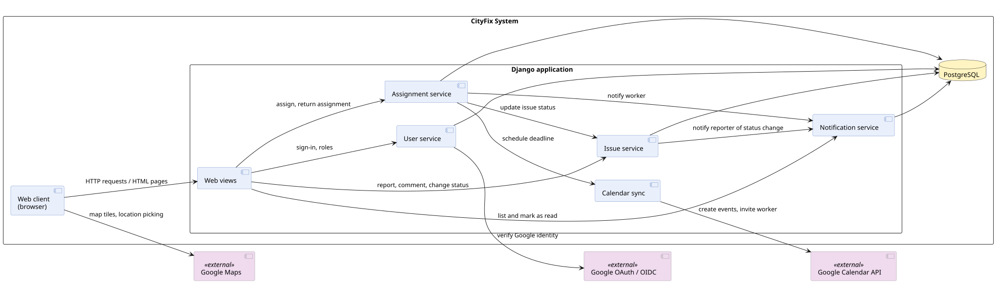
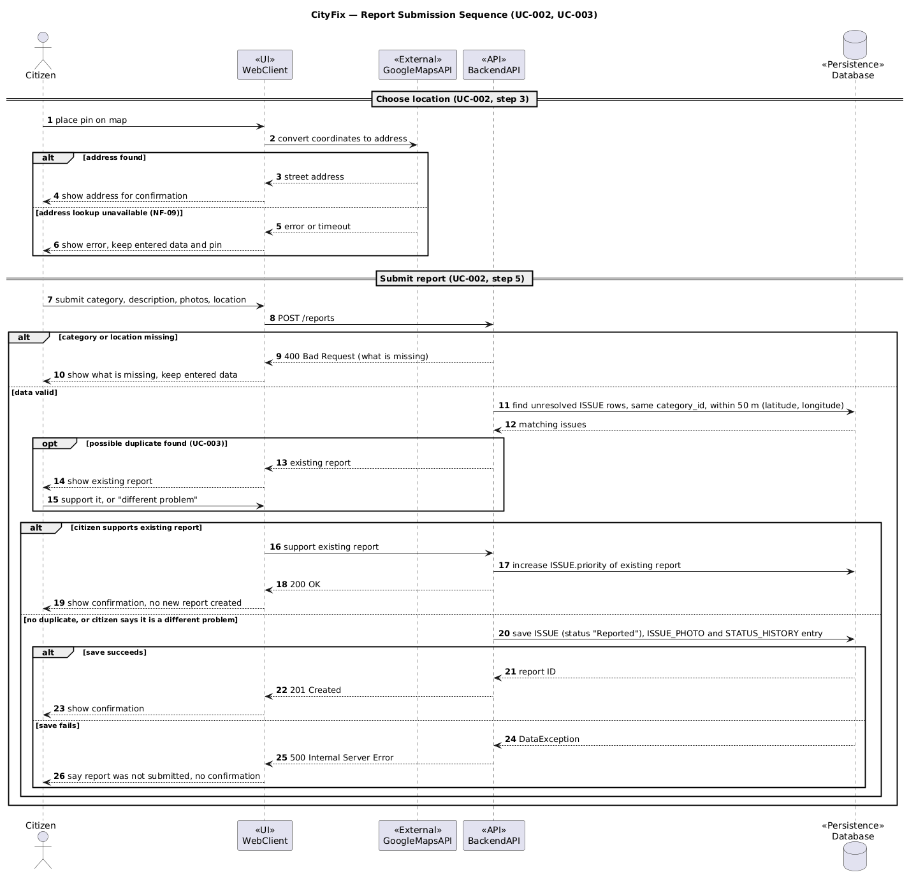
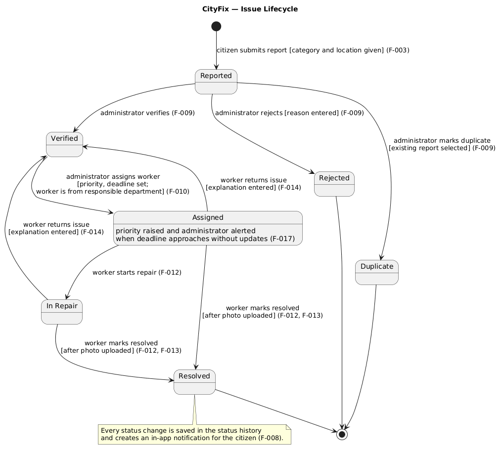

# 4. Architecture and Design

**Objective:** Design and explain the application's boundary, main choices, parts, data, and important behavior. Start with an architecture that guides implementation; revise it when design decisions change. At the final review, the descriptions and diagrams should explain the application that was actually built.

The page contains the **UML component, class, sequence, and state diagrams** and the data model. The use case diagram describes user goals; the deployment diagram shows where the finished application actually runs. Keep a readable image and versioned PlantUML source for each UML diagram, as described on [Home](./Home.md).

The expandable Crisis Guard examples illustrate a proposed design. Use your project's own decisions and models in the completed page.

| View | Main question |
| --- | --- |
| Solution strategy | Which architectural choices were made, and why? |
| Building blocks | What are the principal parts, their responsibilities, and their external connections? |
| Data and class design | What information is stored, and how is a representative part of the code structured? |
| Runtime behavior | How do parts collaborate, and how does a meaningful object change state? |
| Architectural decisions | Why was a consequential option chosen over alternatives? |
| Crosscutting concepts and risks | Which shared mechanisms and important compromises affect the design? |

## 4.1 Solution Strategy

**Objective:** Explain the few architectural choices that most affect the solution and their project-specific reasons.

| Decision | Alternative considered | Project-specific rationale and trade-off |
| --- | --- | --- |
|  |  |  |

Explain the main architectural choices without repeating the technologies list. If an important choice has an ADR, its ID in the table is enough.

<strong>Explaining a choice </strong>

**Example — Crisis Guard:**

| Decision | Alternative considered | Project-specific rationale and trade-off |
| --- | --- | --- |
| Browser client and one backend API | Several separately deployed backend services | The client displays the map while the backend validates and stores reports. One backend is manageable for this scope; its failure may interrupt report operations. See ADR-01 for the reasoning. |
| Relational storage for reports | Document-oriented storage | Reports have identifiable links to users and locations. A relational schema makes these relationships explicit but requires migrations when the schema changes. |

**Analysis of the example:** Both decisions state a reason tied to the reporting application and acknowledge a trade-off. The backend choice links to ADR-01 rather than repeating the full comparison. Modules within one deployable backend are not separate microservices. In your own table, include alternatives that the team genuinely considered.

## 4.2 Building Blocks and UML Component Diagram

**Objective:** Propose the principal parts of the application, assign their responsibilities, and show their dependencies without diagramming every file or class. Revise this view as the system takes shape.

**CityFix component diagram:** 
  
**PlantUML source:** [component-diagram.puml](./puml/component-diagram.puml)

| Component | Responsibility | Reason for this boundary |
| --- | --- | --- |
| Web client | Displays the HTML pages generated by Django, shows the Google map and issue lists, and uses HTMX to update parts of the page. | User interaction is separated from issue rules and persistence. |
| Web views | Receives HTTP requests and HTMX requests, checks the user's role, and returns full pages or HTML fragments. | HTTP-facing responsibilities are separated from business logic. |
| User service | Handles Google sign-in, user accounts and roles, and deletes personal data when an account is removed. | Identity, permissions and personal data have a single owner. |
| Issue service | Creates, classifies and comments on issues, uploads photos to Cloudinary, marks duplicates and changes status. | Issue rules and status history are applied in one place, whoever triggers the change. |
| Assignment service | Assigns issues to city workers with a deadline and handles returned assignments. | Work allocation rules are kept separate from the issue lifecycle. |
| Notification service | Creates in-app notifications and lists them for each user. | Notifying users is separate from the actions that cause the notification. |
| Calendar sync | Turns assignments into Google Calendar events and invites the worker. | Communication with the external calendar API is isolated in one place. |

Start by drawing the boundary around the proposed system. Inside it, identify parts with distinct responsibilities; put a planned application database inside this boundary and third-party services outside it. Label important connections with what crosses them. A logical component may be a module within one backend application: a separate box does not imply a separately deployed service. As you implement, update the diagram when responsibilities or connections change. In the final version, readers should be able to relate its parts to the code. The deployment diagram answers where those parts actually run.

<strong>System boundary, responsibilities, and external dependencies</strong>

**Example — Crisis Guard:** The proposed architecture supports report submission, a map view, and notifications about confirmed reports.

  
[PlantUML source](./puml/4-1-crisis-guard-system-CMP.puml)

| Part | Responsibility | Reason for this boundary |
| --- | --- | --- |
| Web client | Shows reports and collects a new report. | User interaction is separated from report rules and persistence. |
| Report API | Accepts report requests and returns responses. | HTTP-facing responsibilities are separated from report processing. |
| Report service | Applies report rules and accesses stored reports. | Report validation and storage rules have a clear owner. |
| Notification worker | Identifies eligible recipients and asks an external provider to send an alert. | Notification work is separate from answering a user's report request. |

**Analysis of the example:** The outer boundary distinguishes the proposed system from the map provider and the notification provider. The inner boundary groups the Report API, Report service, and Notification worker within one backend application; their separate symbols express proposed responsibilities, not independently deployed services. PostgreSQL stores application data, while the map provider supplies map tiles. The arrows summarize dependencies, not the order of a transaction; the sequence diagram covers that order. Omit the Notification worker and Firebase Cloud Messaging if notifications are outside the approved scope. If separating the Report API from the Report service does not help explain the design, show one backend component. Include a sign-in provider only if the approved task calls for it. As implementation progresses, revise any proposed boundary that proves inaccurate; the final diagram must correspond to what the team built. One coherent component view is more useful than several near-identical versions with conflicting connections.

## 4.3 Data and Detailed Design

**Objective:** Explain the important information the application stores and one representative area of class-level design. The data model and UML class diagram answer different questions; one does not replace the other.

### 4.3.1 ER Diagram and Data Model

**Objective:** Show the important stored entities, their identifiers and relationships, and enough attributes to explain the application's data. The ER diagram is separate from the representative UML class diagram below.

**ER diagram:** [Embed the project's readable diagram.]  
**Diagram source:** [Link to its versioned source.]  
**Implementation:** [Indicate where the corresponding data model is defined in the project.]

<strong>One flood report and its related data</strong>

**Example — Crisis Guard:** Ana submits flood report `R-104` using her citizen account. She selects a location on the map and records the severity as high. A citizen may submit several reports; each report belongs to one disaster category, such as *Flood*. The application stores the report and its coordinates. Map tiles come from an external provider and are not entities in the application's data model.

  
[PlantUML source](./puml/4-2-crisis-guard-data-ERD.puml)

**Analysis of the example:** `R-104` has one author and one category; Ana and the *Flood* category can each be linked to more reports. The diagram shows relationships without copying a database's columns or writing a second table description for every entity. If your application also accepts **anonymous** reports, represent that possibility in the relationship to `Citizen`. If categories are fixed values rather than stored records, do not invent a category table. Compare the final ER diagram with the persistence model and explain only differences that matter to understanding the project.

### 4.3.2 Representative UML Class Diagram

**Objective:** Before implementing a representative part of the system, model the classes or interfaces needed to assign responsibilities, operations, and relationships. Revise the design when those choices change.

**Class diagram:** [Embed a readable UML class diagram for a representative part of the design.]  
**PlantUML source:** [Link to the matching versioned `.puml` file.]  
**Code reference at the final review:** [Link to the corresponding implementation.]

<strong>Designing report responsibilities and allowed changes</strong>

**Example — Crisis Guard:** A report owns the rules for changing its status. A workflow class coordinates submission and review, while a repository interface describes the persistence operations it needs. The diagram proposes these responsibilities before implementation.

  
[PlantUML source](./puml/4-3-crisis-guard-domain-CD.puml)

**Analysis of the example:** `DisasterReport` owns its allowed state changes, so the workflow cannot silently approve a rejected report. `ReportWorkflow` coordinates an operation without owning the report's transition rules; `ReportRepository` defines the storage operations it needs. The `Location` composition and selected types show relationships useful to the design. The diagram intentionally omits database columns and unrelated classes: the ER model explains stored data, while this diagram assigns program responsibilities and operations. These classes are a design choice, not required layers for every team. Compare the finished implementation with the original design and revise the diagram where decisions changed; generating a diagram from code at the end cannot substitute for this initial modeling.

## 4.4 Runtime Behavior

**Objective:** Explain one important interaction among running parts and the lifecycle of one meaningful object. Choose cases that expose decisions or failure paths instead of making a diagram for every CRUD action.

### 4.4.1 Representative UML Sequence Diagram

**Objective:** Show the order of messages for one representative scenario and the responses to a meaningful alternative.

**Scenario:** Submitting a report with location selection, validation and duplicate check (UC-002, UC-003). The interaction also shows what happens when the address lookup is unavailable (NF-09), required data is missing, the citizen supports an existing report instead of creating a new one, or saving fails.  
**Sequence diagram:**  
  
**PlantUML source:** [sequence-report-submission.puml](./puml/sequence-report-submission.puml)

<strong>Location selection, validation, and report submission</strong>

**Example — Crisis Guard:** A citizen submits a disaster report after choosing a location manually or requesting the device's position. The interaction also shows what happens when location permission is denied, report data is invalid, or storage fails.

  
[PlantUML source](./puml/4-4-crisis-guard-report-submission-SD.puml)

**Analysis of the example:** The two location paths and the validation and storage alternatives have different consequences for the user; compare them with the matching use case and its alternative flows. The browser location API is a browser capability; the web client, API, service, and store correspond to the component view. Select branches that help explain your project's scenario, and revise the final diagram to match the implemented interaction.

### 4.4.2 Representative UML State Diagram

**Objective:** Show the meaningful states of one domain object or an explicitly managed system mode, and the events or conditions that change it.

**State owner and reason for choosing it:** The Issue (report). Its current state is stored in the `status` field of the ISSUE table, and every change is recorded in STATUS_HISTORY (old status, new status, who changed it, note). The transitions matter because they decide who can act next: the Administrator verifies, rejects or assigns a report, and the City Worker repairs or returns it. Some transitions have conditions, such as a reason for a rejection, an explanation when a worker returns an issue, and an "after" photo before an issue can be resolved. Every status change also creates an in-app notification for the citizen who reported the issue (F-008).  
**State diagram:**  
  
**PlantUML source:** [state-issue-lifecycle.puml](./puml/state-issue-lifecycle.puml)

<strong>Operating modes and service availability</strong>

**Example — Crisis Guard:** The crisis coordination mode changes as an disaster is assessed and resolved. At the same time, the user-visible availability of the application may change independently when the map provider or backend becomes unavailable.

  
[PlantUML source](./puml/4-5-crisis-guard-report-SM.puml)

**Analysis of the example:** The two regions describe independent aspects of the modeled system: its crisis coordination mode and observed service availability. They run in parallel; an active crisis may coincide with normal or limited service. The branches after backend recovery account for a map provider that may still be unavailable. State transitions have named triggers or guards rather than being a list of screens. Use this form only if your application actually maintains or reliably derives both kinds of state. A project whose meaningful lifecycle belongs to a report, reservation, or order should model that object instead; diagram complexity is not an assessment criterion. At the final review, check the state model against the behavior the running application supports.

## 4.5 Architecture Decision Records

**Objective:** Preserve the reasons for consequential architectural choices so a future developer can understand what was decided, what alternative was considered, and which trade-off the team accepted.

**Decision index:**

| ID | Date | Decision | Alternative considered | Rationale and trade-off | Status |
| --- | --- | --- | --- | --- | --- |
| ADR-01 | 05.11.2026 | One Django backend, split into apps, deployed as a single service | Several separately deployed services | With six people and one semester, one backend is something we can actually build, deploy and explain. The downside is that if the backend goes down, everything goes down with it. | Accepted |
| ADR-02 | 16.10.2026 | Django templates with HTMX, and the Google Maps JavaScript API for the map | A React or Angular frontend talking to a REST API | We keep one codebase and do all permission checks on the server. The map still needs some plain JavaScript, since HTMX alone is not enough there. | Accepted |
| ADR-03 | 17.10.2026 | PostgreSQL as our only database | MongoDB, SQLite | Our data is very connected (users, issues, assignments, status history), and a status change has to be saved together with its history and notification. A relational database fits that well. The cost is writing migrations whenever the schema changes. | Accepted |
| ADR-04 | 16.10.2026 | Sign-in only with Google. Worker and admin accounts are created in advance by an Administrator using the person's email | Our own username/password login, or several sign-in providers | We store no passwords and skip registration and password reset entirely (C-01, NF-05). Anyone without a Google account can't use the app, and a worker who signs in with a different email ends up as a regular Citizen. | Accepted |
| ADR-05 | 05.11.2026 | Photos go to Cloudinary, and the database only keeps the link | Render's local disk, or storing images in PostgreSQL | Files on Render's disk can disappear on redeploy, and images would bloat the database. We now rely on one more external service, and if saving a report fails after the upload, an unused photo stays in Cloudinary. | Accepted |
| ADR-06 | 05.11.2026 | Notifications only inside the app, saved together with the status change | E-mail or push notifications | No extra service, API key or background job to set up, and a notification can't get lost separately from the change it describes. Users only see notifications when they open the app. | Accepted |
| ADR-07 | 05.11.2026 | Hosting on Render: one web service and one managed PostgreSQL database | Our own virtual server, Railway or Heroku | Render gives us HTTPS, deploys from GitHub and a managed database, so nobody on the team has to run a server. There is only one instance, and on the free plan the app goes to sleep when idle, so the first request after a break is slow. | Accepted |
| ADR-08 | 20.10.2026 | Deleting an account removes the citizen's personal data, but their reports stay, without a link to them | Deleting the reports too, or only deactivating the account | This meets the GDPR right to erasure without losing issues the city may still be working on. It means a report can now exist without an author. | Accepted |

**Detailed ADR, when the decision needs more explanation:**

### ADR-01: One Django backend instead of separate services

| Field | Record of the decision |
| --- | --- |
| Context and goal | CityFix has to handle sign-in and roles, reporting issues with photos and a map, validation, assigning work to City Workers, status updates and notifications. We need to build all of this, deploy it publicly and be able to explain it, within one semester. |
| Decision criteria | Can we realistically build and deploy it in time? Is it clear where each part of the logic lives? Do changes that touch several areas, such as a status update that also writes history and a notification, stay consistent? Can we host it for free or close to it? |
| Alternatives considered | **One backend split into apps:** accounts, issues, assignments and notifications are separate Django apps, but they run as one program with one database. **Separate services:** each part could run and scale on its own, but every service needs its own deployment, the services have to talk to each other over HTTP, and we would have to deal with one being down while the others are up. |
| Decision and rationale | We went with one Django project split into apps, running as one service on Render. Because the apps call each other directly and share one database transaction, it is easy to make sure every status change also creates a history entry and a notification (see 4.6). What we give up is isolation: a bug in one app or a broken deploy takes the whole application down. The apps are the components shown in 4.2, not separate services. |
| Status | Accepted. |

### ADR-02: Server-rendered pages with HTMX instead of a single-page app

| Field | Record of the decision |
| --- | --- |
| Context and goal | Each of the three roles has its own screens: citizens report and follow issues, City Workers update the issues assigned to them, and Administrators validate and assign reports. Every role must only see what it is allowed to (NF-06), and everything has to work on a phone (NF-12). |
| Decision criteria | We want access rules and validation written in one place, we want to work mostly in Python and Django, some parts of the page (filters, status changes, notifications) should update without a full reload, and the map needs a JavaScript library either way. |
| Alternatives considered | **React or Angular with a REST API:** a smoother interface, but it means a second codebase, a separate build and deploy, an API endpoint for every screen, and permission checks on both sides. **Django templates with HTMX:** the server sends ready HTML, and HTMX swaps out parts of the page when needed, so we only write JavaScript where we really need it. |
| Decision and rationale | We chose Django templates with HTMX, plus the Google Maps JavaScript API on the map pages. Django checks the user's role before it builds a page, so the browser never gets data the user isn't allowed to see (NF-06, NF-07). The catch is the map: markers and filters need hand-written JavaScript that gets the report data from Django as JSON. We also don't end up with a general API that a mobile app could use later. |
| Status | Accepted. |

### ADR-08: Deleting an account keeps the reports but removes the link to the user

| Field | Record of the decision |
| --- | --- |
| Context and goal | Under GDPR, a citizen can ask us to delete their personal data (F-021, C-07). Their reports, though, are about real problems in the street, and a City Worker may already be fixing them. |
| Decision criteria | Nothing that identifies the citizen may remain, the city's work on open issues shouldn't be interrupted, and the rule should be simple to build and test. |
| Alternatives considered | **Delete the reports too:** the simplest option for privacy, but open repairs would just vanish from workers' lists. **Only deactivate the account:** easy to undo, but the name, email and Google ID would still be stored, so nothing is really deleted. **Delete the user, keep the reports without an author:** the reports stay, and nobody can tell who sent them. |
| Decision and rationale | We delete the user and their notifications, and clear the author field on their reports and photos (`ISSUE.reporter_id` and `ISSUE_PHOTO.uploaded_by_id`, using `on_delete=SET_NULL` in Django). The public map never showed who reported an issue (NF-07), so nothing changes there. This does mean both fields have to allow empty values, so in the ER diagram a report has zero or one reporter instead of exactly one. Nobody gets notified about those reports anymore, and the deletion can't be undone. If the same person signs in again later, they simply get a new, empty Citizen account. |
| Status | Accepted. |

Write an ADR only for a choice whose rationale will matter after the implementation changes. A significant change of decision can be recorded as a new ADR that supersedes the old one; routine tool choices do not need detailed records. Changes to agreed scope belong with requirements and their change history; feedback on a task stays with its issue.

<strong>Choosing one backend instead of separately deployed services</strong>

**Example — Crisis Guard, ADR-01:**

| ID | Date | Decision | Alternative considered | Rationale and trade-off | Status |
| --- | --- | --- | --- | --- | --- |
| ADR-01 | [Date of decision] | One backend API for report handling | Separate deployable report and resource services | Lower deployment and integration effort for the approved scope; a failure of the backend can affect both features. | Accepted |

### ADR-01: One backend API for report handling

| Field | Record of the decision |
| --- | --- |
| Context and goal | The team must deliver and publicly deploy reporting and a map-oriented view during one semester. |
| Decision criteria | The team can build, integrate, deploy, and explain the solution; components still have identifiable responsibilities. |
| Alternatives considered | **One backend:** modules share a deployable application. **Separate services:** each can run independently, but they require additional integration and deployment work. |
| Decision and rationale | Choose one backend, with distinguishable report responsibilities inside it. This limits deployment work but accepts that a failure of this backend may affect report operations together. |
| Status | Accepted. |

**Analysis of the example:** The solution strategy states the current approach; ADR-01 preserves the alternatives and criteria that led to it. The component and deployment diagrams should reflect the chosen approach as it develops. A separate ADR is useful for a consequential decision, not for every tool choice.

## 4.6 Crosscutting Concepts

**Objective:** Identify an important mechanism or design rule that applies to several parts of the application, describe where it is planned to apply, and update the explanation as the implementation takes shape. Include only concepts that matter to this project.

| Concern | Mechanism and where it applies | Evidence in the final implementation |
| --- | --- | --- |
| Authentication and authorization | Users sign in only through Google (OAuth 2.0/OpenID Connect) and are identified by `USER.google_sub` and `USER.email`; no password is stored. The system restricts the application's functionalities according to the user and their role: the backend checks `USER.role` (Citizen, City Worker, Administrator) and `USER.is_active`, and checks ownership of the data (a citizen sees their own reports, a worker only issues assigned to them). This applies to the user management, issue management and assignment functionalities. | At the final review, show the sign-in callback, the permission check used by the backend endpoints, and a test that attempts every restricted action with each role and is denied when unauthorized. |
| Issue status management and history | Issue statuses change only through one backend operation that checks the actor's role, requires an "after" photo before "Resolved", and records the change. Whenever an issue status changes, the previous status, new status, user responsible, date and optional note are stored in `STATUS_HISTORY`. This provides traceability. | Show a status update and the corresponding creation of STATUS_HISTORY records. |
| Data validation and integrity | The backend validates input before storing it: a report needs a category and a valid location (latitude & longitude or address), uploaded files must be accepted image files, and an assignment needs a priority, a deadline and a worker from the department responsible for the category. Invalid data is rejected and nothing is saved.  | Show backend validation rules, database constraints and tests using invalid or incomplete data. |
| Notification management | The notification mechanism informs relevant users about events related to reported issues. A `NOTIFICATION` row (associated issue, recipient and notification type) is created in the same transaction as the event. The reporting citizen is notified in the application after each status change, and the Administrator after an overdue issue is escalated. Applies to status updates, validation, assignment and returns. | At the final review, show where notifications are created and tests verifying that each is linked to the correct issue and recipient and appears within 10 seconds of a status change. |
| External service integration and error handling | CityFix relies on external services for mapping, geocoding, calendar integration and weather forecasts. Google Maps API supports map display and location services, Google Calendar API handles worker scheduling, and an external weather API provides forecasts. The application handles unavailable services by displaying appropriate error messages and allowing unaffected operations to continue. | Show the API integrations and tests simulating unavailable external services. |

## 4.7 Architectural Risks and Technical Debt

**Objective:** State real technical or domain risks and consciously accepted design compromises, their consequences, and what the team will do about them.

**Technical risks and debt**

| Risk or compromise | Consequence | Current treatment |
| --- | --- | --- |
|  |  |  |

**Business or domain risks, if significant**

| Risk | Consequence | Current treatment |
| --- | --- | --- |
|  |  |  |

<strong>Identifying a limitation without inventing production infrastructure</strong>

**Example — Crisis Guard, technical risks:**

| Risk or compromise | Consequence | Current treatment |
| --- | --- | --- |
| One application instance handles report submissions. | Hosting failure temporarily prevents new reports. | Accepted within the course project; the team does not claim automatic failover. |
| External map tiles are unavailable. | The map view may fail even when stored reports remain available. | Explain the visible error or fallback that the implemented application actually provides. |

**Example — Crisis Guard, domain risk:** Readers may mistake an unverified citizen report for an official warning. The team can distinguish the report's verification status in the interface and direct readers to official channels.

**Analysis of the example:** The first technical risk accepts a realistic course-scope limitation; the domain risk concerns how a reader interprets a report. Record a limitation and a realistic response that belong to your own project. A missing mandatory feature is unfinished scope, not technical debt.

**Final consistency check:** Compare the component, data, class, sequence and state views with the implemented code, application behavior, and actual deployment. Update outdated design descriptions and explain any important difference that remains; links to relevant code or tests help when they resolve a concrete question.
