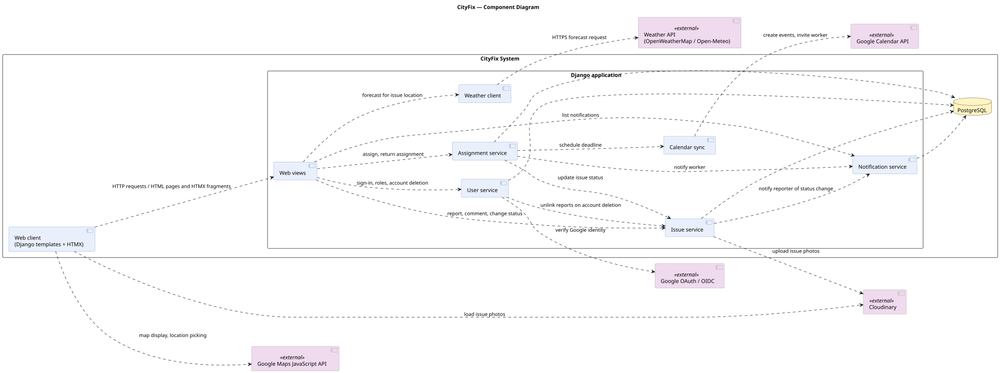
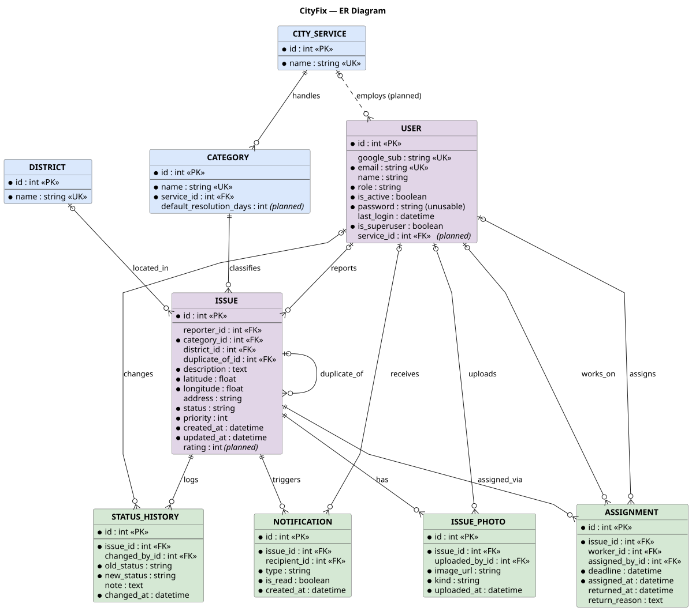
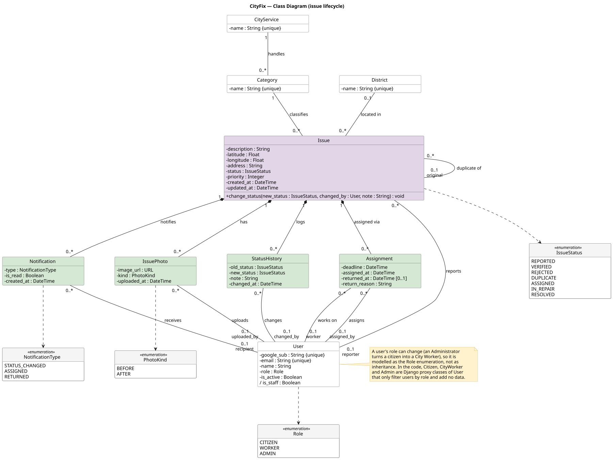
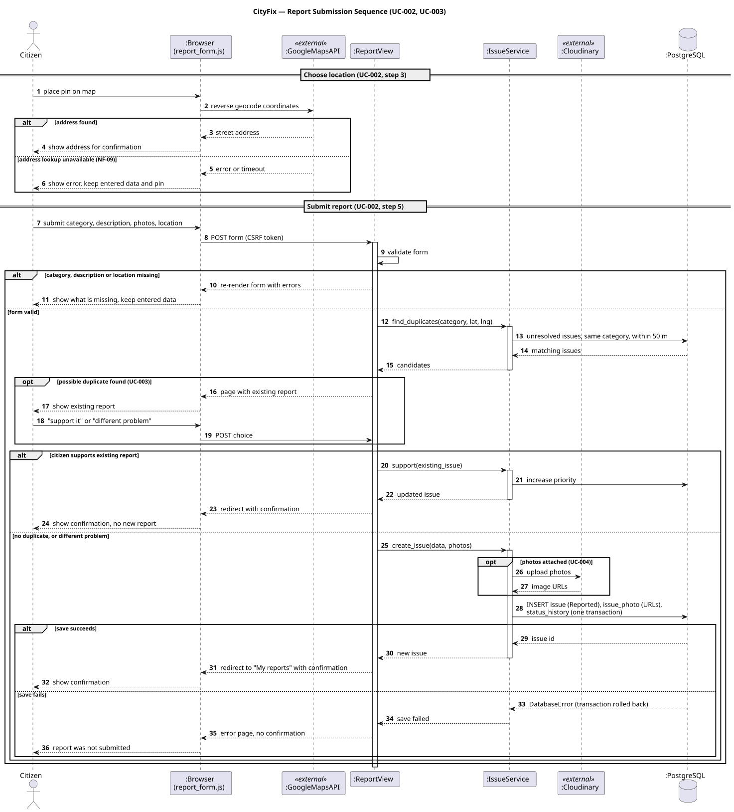
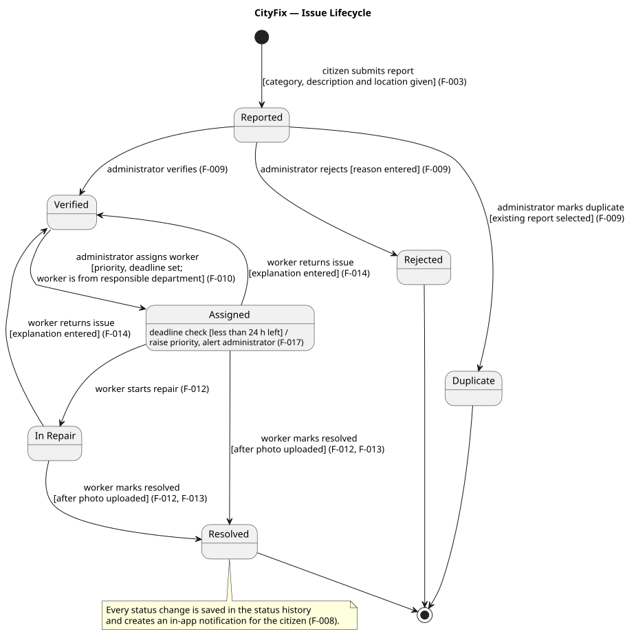

# 4. Architecture and Design

**Objective:** Design and explain the application's boundary, main choices, parts, data, and important behavior. Start with an architecture that guides implementation. Revise it when design decisions change. At the final review, the descriptions and diagrams should explain the application that was actually built.

This page contains the UML component, class, sequence and state diagrams and the ER data model of CityFix. The use case diagram is in [3. Use Cases](./3-Use-Cases.md), and the deployment diagram belongs in [6. Deployment](./6-Deployment-Installation-and-Configuration.md). All diagrams are PlantUML models. Each diagram has its source in [`docs/puml/`](./puml/) and its image in [`docs/assets/diagrams/`](./assets/diagrams/).

| View | Main question |
| --- | --- |
| Solution strategy | Which architectural choices were made, and why? |
| Building blocks | What are the principal parts, their responsibilities, and their external connections? |
| Data and class design | What information is stored, and how is a representative part of the code structured? |
| Runtime behavior | How do parts collaborate, and how does a meaningful object change state? |
| Architectural decisions | Why was a consequential option chosen over alternatives? |
| Crosscutting concepts and risks | Which shared mechanisms and important compromises affect the design? |

## 4.1 Solution Strategy

**Objective:** Explain the few architectural choices that most affect the solution and their project-specific reasons.

| Decision | Alternative considered | Project-specific rationale and trade-off |
| --- | --- | --- |
| One Django backend, organised as separate apps (`users`, `issues`), with server-rendered Django templates | Separately deployed services, or a separate frontend and API | Citizens, City Workers and Administrators all work on the same issues, so one deployable keeps authentication, permissions and data in one place and is manageable for a team of six. A backend failure interrupts every role, and all apps share one codebase and release cycle. See ADR-01, ADR-02. |
| Relational database through the Django ORM and migrations: SQLite for local development, PostgreSQL in production | Document-oriented storage | An issue is explicitly linked to its reporter, category, district, photos, status history and assignments. A relational schema enforces these links and supports the statistics use case (UC-015). Every schema change needs a migration the team must coordinate. The custom user model had to exist before the first migration. See ADR-03. |
| Google sign-in (OIDC via django-allauth) as the only way to log in | Own email and password accounts | Citizens report without another password, and CityFix stores none (C-01). `google_sub` identifies the person even if the email changes. CityFix depends on Google's availability and every user needs a Google account. Workers and admins are created by an Administrator with their email and linked on first sign-in. See ADR-04. |
| One `User` table with a `role` column. `Citizen`, `CityWorker` and `Admin` are proxy subclasses | One table per subclass (multi-table inheritance) | Django needs one user model for authentication, and every foreign key to a user (reporter, worker, changed by) stays simple. The class diagram (§4.3.2) models the role as the `Role` enumeration, and the ER diagram (§4.3.1) maps all roles to one USER table. Role-specific columns such as `service_id` stay empty for other roles, and the rules per role are enforced in code (`users/permissions.py`: role mixins and the `role_required` decorator), not by the database. |
| Account deletion removes the user row. Foreign keys to users are nullable with `SET_NULL` | Cascade delete, or keeping the row and blanking its fields | Personal data must disappear while reports stay part of the city's record (F-021). Deleting the row guarantees no personal data remains. Every user foreign key must be declared `null=True, on_delete=SET_NULL`, and old reports and assignments lose their author or worker. See ADR-08. |
| Status changes and assignments stored as their own records (STATUS_HISTORY, ASSIGNMENT) beside the current `status` on the issue | Only a current status and assigned worker on the issue | Status tracking and statistics need to know who changed what and when, and a returned assignment keeps its reason before the issue goes to another worker. Every change needs extra writes, which must happen in the same transaction as the status update so the issue and its history never disagree. |
| Photos, maps, calendar and weather come from external services called from isolated components | Building or hosting these features ourselves | Saves development time and storage. Each integration needs a defined fallback when the service is unavailable (NF-09, UC-008 2a, UC-013 5a). See ADR-05 and §4.6. |

## 4.2 Building Blocks and UML Component Diagram

**Objective:** Propose the principal parts of the application, assign their responsibilities, and show their dependencies without diagramming every file or class. Revise this view as the system takes shape.

**CityFix component diagram:**  
  
**PlantUML source:** [component_diagram.puml](./puml/component_diagram.puml)

The components are logical parts of one Django project, not separately deployed services (ADR-01).

| Component | Responsibility | Reason for this boundary |
| --- | --- | --- |
| Web client | Displays the HTML pages generated by Django, shows the Google map and issue lists, and uses HTMX to update parts of the page. | User interaction is separated from issue rules and persistence. |
| Web views | Receives HTTP and HTMX requests, checks the user's role, and returns full pages or HTML fragments. | HTTP-facing responsibilities are separated from business logic. |
| User service | Handles Google sign-in, user accounts and roles, and deletes personal data when an account is removed. | Identity, permissions and personal data have a single owner. |
| Issue service | Creates, classifies and comments on issues, uploads photos to Cloudinary, marks duplicates and changes status. | Issue rules and status history are applied in one place, whoever triggers the change. |
| Assignment service | Assigns issues to City Workers with a deadline and handles returned assignments. | Work allocation rules are kept separate from the issue lifecycle. |
| Notification service | Creates in-app notifications and lists them for each user. | Notifying users is separate from the actions that cause the notification. |
| Calendar sync | Turns assignments into Google Calendar events and invites the worker. | Communication with the external calendar API is isolated in one place. |
| Weather client | Fetches the forecast for an issue's location for workers and administrators (F-016). | A slow or unavailable weather service must not block viewing or assigning an issue. |

**Mapping to the code and implementation status (checkpoint 1):**

| Component | Code location | Status |
| --- | --- | --- |
| Web client | `code/issues/templates/`, `code/issues/static/issues/js/` | Templates for the home page, public map, report form, "My reports", notifications, admin list, review, assignment and worker task list are in use. HTMX is not yet used. |
| Web views | `code/issues/views.py`, `code/issues/views_admin.py`, `code/issues/views_worker.py`, `code/issues/views_map.py`, `code/issues/views_home.py`, `code/users/views.py` | The public map, report creation, "My reports", notifications, admin review and assignment, worker task list and status update, and account deletion are implemented. The report details page is not yet connected. |
| User service | `code/users/adapters.py`, `code/users/permissions.py`, `code/users/services.py` | Google sign-in, role checks and account deletion are implemented. |
| Issue service | `code/issues/services.py` (`create_report`, `upload_photo`), `code/issues/models.py` (`Issue.change_status`) | Report creation with photo upload to Cloudinary is implemented. A failed upload saves nothing. Each status change writes a history entry and a notification in one transaction. Duplicate detection is planned. |
| Assignment service | `code/issues/views_admin.py`, `code/issues/forms.py` | Assignment is implemented. Filtering workers by department and returning an issue are planned. |
| Notification service | `code/issues/services.py` (`notify`), `code/issues/views.py` | Implemented. Notifications are created for the citizen on every status change and for the worker when an issue is assigned to them, listed on the notifications page and counted in the navigation bar. |
| Calendar sync, Weather client | — | Planned. |

## 4.3 Data and Detailed Design

**Objective:** Explain the important information the application stores and one representative area of class-level design. The data model and UML class diagram answer different questions. One does not replace the other.

### 4.3.1 ER Diagram and Data Model

**Objective:** Show the important stored entities, their identifiers and relationships, and enough attributes to explain the application's data. The ER diagram is separate from the representative UML class diagram below.

**ER diagram:**  
  
**PlantUML source:** [er_diagram.puml](./puml/er_diagram.puml)

**Implementation:** Django models in [`code/users/models.py`](../code/users/models.py) and [`code/issues/models.py`](../code/issues/models.py). The schema is created by the migrations in `code/users/migrations/` and `code/issues/migrations/`.

| Entity | Purpose |
| --- | --- |
| USER | One table for all three roles (`role` = citizen, worker or admin). `google_sub` and `email` identify the Google account. `password`, `last_login` and `is_superuser` come from Django's `AbstractBaseUser` and `PermissionsMixin`. Users who sign in with Google get an unusable password, so no password is used for sign-in (C-01). |
| CITY_SERVICE | A city department (for example, road maintenance). Each category belongs to one department, and City Workers will belong to one department so that only suitable workers can be assigned (F-010). The documentation uses "department". The code uses `CityService`. |
| CATEGORY | Type of problem (pothole, streetlight, ...) and the department that handles it. |
| DISTRICT | Optional city area of an issue, used for filtering and statistics. |
| ISSUE | A reported problem with location, description, current status and priority. `reporter_id` may be empty after the citizen deletes their account (ADR-08). `duplicate_of_id` links a duplicate to the original report. |
| ISSUE_PHOTO | Link to a "before" photo from the citizen or an "after" photo from the worker (F-013). Only the URL is stored. The file is in Cloudinary (ADR-05). |
| STATUS_HISTORY | Every status change: old and new status, who changed it, when, and an optional note. The note is also the worker's comment shown in the issue history (F-012). |
| ASSIGNMENT | Assignment of an issue to a worker with a deadline. A returned assignment keeps `returned_at` and `return_reason` (F-014), so an issue can have several assignments over time. |
| NOTIFICATION | In-app notification for a user about an issue (F-008). |

Attributes marked *(planned)* in the diagram are part of the design but not yet in the models: `USER.service_id` (F-010), `CATEGORY.default_resolution_days` (F-017) and `ISSUE.rating` (F-018).

### 4.3.2 Representative UML Class Diagram

**Objective:** Before implementing a representative part of the system, model the classes or interfaces needed to assign responsibilities, operations, and relationships. Revise the design when those choices change.

**Class diagram:**  

  
**PlantUML source:** [class_diagram.puml](./puml/class_diagram.puml)

**Code reference:** [`code/users/models.py`](../code/users/models.py), [`code/issues/models.py`](../code/issues/models.py)

The diagram covers the issue lifecycle, the central part of CityFix. A user's role can change, because an Administrator can turn a citizen into a City Worker, so the role is modelled as the `Role` enumeration and not as inheritance. In the code, `Citizen`, `CityWorker` and `Admin` are Django proxy classes of `User` that only filter users by role and add no data. The role a user plays in each association is shown by the role name at its end (reporter, worker, assigned_by, changed_by, uploaded_by, recipient). `Issue` owns its history, photos, assignments and notifications (composition: they are deleted with the issue), while links to `User` are plain associations, so deleting a user keeps the issues (ADR-08). `Issue.change_status()` is the single operation for changing a status. It records a `StatusHistory` entry and then saves the new status.

## 4.4 Runtime Behavior

**Objective:** Explain one important interaction among running parts and the lifecycle of one meaningful object. Choose cases that expose decisions or failure paths instead of making a diagram for every CRUD action.

### 4.4.1 Representative UML Sequence Diagram

**Objective:** Show the order of messages for one representative scenario and the responses to a meaningful alternative.

**Scenario:** Submitting a report with location selection, validation and duplicate check (UC-002, UC-003). The interaction also shows what happens when the address lookup is unavailable (NF-09), required data is missing, the citizen supports an existing report instead of creating a new one, or saving fails. Because CityFix uses server-rendered pages (ADR-02), the browser posts a Django form and receives a re-rendered page or a redirect, not a JSON API response.  
**Sequence diagram:**  
  
**PlantUML source:** [sequence_report_submission.puml](./puml/sequence_report_submission.puml)

**Implementation status (checkpoint 1):** validation, photo upload to Cloudinary and saving the report are implemented as shown (`views.report_create`, `services.create_report`). Photos are uploaded before anything is saved, so a failed upload leaves no partial report. The duplicate check and supporting an existing report (UC-003) are planned. The status history starts with the first status change after the report is submitted.

### 4.4.2 Representative UML State Diagram

**Objective:** Show the meaningful states of one domain object or an explicitly managed system mode, and the events or conditions that change it.

**State owner and reason for choosing it:** The Issue (report). Its current state is stored in the `status` field of the ISSUE table (`Issue.Status` in `code/issues/models.py`), and every change is recorded in STATUS_HISTORY (old status, new status, who changed it, note). The transitions matter because they decide who can act next: the Administrator verifies, rejects or assigns a report, and the City Worker repairs or returns it. Some transitions have conditions, such as a reason for a rejection, an explanation when a worker returns an issue, and an "after" photo before an issue can be resolved. Every status change also creates an in-app notification for the citizen who reported the issue (F-008).  
**State diagram:**  
  
**PlantUML source:** [state_issue_lifecycle.puml](./puml/state_issue_lifecycle.puml)

**Implementation status (checkpoint 1):** the transitions Reported → Verified and Reported → Rejected (`views_admin.review_issue`), Verified → Assigned (`views_admin.assign_issue`) and Assigned → In Repair → Resolved (`views_worker.update_task_status`) are implemented. Every status change creates a notification for the citizen. Marking a duplicate, the "after" photo condition and returning an issue are planned.

## 4.5 Architecture Decision Records

**Objective:** Preserve the reasons for consequential architectural choices so a future developer can understand what was decided, what alternative was considered, and which trade-off the team accepted.

**Decision index:**

| ID | Date | Decision | Alternative considered | Rationale and trade-off | Status |
| --- | --- | --- | --- | --- | --- |
| ADR-01 | 05.11.2026 | One Django backend, split into apps, deployed as a single service | Several separately deployed services | With six people and one semester, one backend is something we can actually build, deploy and explain. The downside is that if the backend goes down, everything goes down with it. | Accepted |
| ADR-02 | 16.10.2026 | Django templates with HTMX, and the Google Maps JavaScript API for the map | A React or Angular frontend talking to a REST API | We keep one codebase and do all permission checks on the server. The map still needs some plain JavaScript, since HTMX alone is not enough there. | Accepted |
| ADR-03 | 17.10.2026 | PostgreSQL as our only database | MongoDB, SQLite | Our data is very connected (users, issues, assignments, status history), and a status change has to be saved together with its history and notification. A relational database fits that well. The cost is writing migrations whenever the schema changes. | Accepted |
| ADR-04 | 16.10.2026 | Sign-in only with Google. Worker and admin accounts are created in advance by an Administrator using the person's email | Our own username/password login, or several sign-in providers | We store no passwords and skip registration and password reset entirely (C-01, NF-05). Anyone without a Google account can't use the app, and a worker who signs in with a different email ends up as a regular Citizen. | Accepted |
| ADR-05 | 05.11.2026 | Photos go to Cloudinary, and the database only keeps the link | Render's local disk, or storing images in PostgreSQL | Files on Render's disk can disappear on redeploy, and images would bloat the database. We now rely on one more external service, and if saving a report fails after the upload, an unused photo stays in Cloudinary. | Accepted |
| ADR-06 | 05.11.2026 | Notifications only inside the app, saved together with the status change | E-mail or push notifications | No extra service, API key or background job to set up, and a notification can't get lost separately from the change it describes. Users only see notifications when they open the app. | Accepted |
| ADR-07 | 05.11.2026 | Hosting on Render: one web service and one managed PostgreSQL database | Our own virtual server, Railway or Heroku | Render gives us HTTPS, deploys from GitHub and a managed database, so nobody on the team has to run a server. There is only one instance, and on the free plan the app goes to sleep when idle, so the first request after a break is slow. | Accepted |
| ADR-08 | 20.10.2026 | Deleting an account removes the citizen's personal data, but their reports stay, without a link to them | Deleting the reports too, or only deactivating the account | This meets the GDPR right to erasure without losing issues the city may still be working on. It means a report can now exist without an author. | Accepted |

**Detailed ADR, when the decision needs more explanation:**

### ADR-01: One Django backend instead of separate services

| Field | Record of the decision |
| --- | --- |
| Context and goal | CityFix has to handle sign-in and roles, reporting issues with photos and a map, validation, assigning work to City Workers, status updates and notifications. We need to build all of this, deploy it publicly and be able to explain it, within one semester. |
| Decision criteria | Can we realistically build and deploy it in time? Is it clear where each part of the logic lives? Do changes that touch several areas, such as a status update that also writes history and a notification, stay consistent? Can we host it for free or close to it? |
| Alternatives considered | **One backend split into apps:** accounts, issues, assignments and notifications are separate Django apps, but they run as one program with one database. **Separate services:** each part could run and scale on its own, but every service needs its own deployment, the services have to talk to each other over HTTP, and we would have to deal with one being down while the others are up. |
| Decision and rationale | We went with one Django project split into apps, running as one service on Render. Because the apps call each other directly and share one database transaction, it is easy to make sure every status change also creates a history entry and a notification (see 4.6). What we give up is isolation: a bug in one app or a broken deploy takes the whole application down. The apps are the components shown in 4.2, not separate services. |
| Status | Accepted. |

### ADR-02: Server-rendered pages with HTMX instead of a single-page app

| Field | Record of the decision |
| --- | --- |
| Context and goal | Each of the three roles has its own screens: citizens report and follow issues, City Workers update the issues assigned to them, and Administrators validate and assign reports. Every role must only see what it is allowed to (NF-06), and everything has to work on a phone (NF-12). |
| Decision criteria | We want access rules and validation written in one place, we want to work mostly in Python and Django, some parts of the page (filters, status changes, notifications) should update without a full reload, and the map needs a JavaScript library either way. |
| Alternatives considered | **React or Angular with a REST API:** a smoother interface, but it means a second codebase, a separate build and deploy, an API endpoint for every screen, and permission checks on both sides. **Django templates with HTMX:** the server sends ready HTML, and HTMX swaps out parts of the page when needed, so we only write JavaScript where we really need it. |
| Decision and rationale | We chose Django templates with HTMX, plus the Google Maps JavaScript API on the map pages. Django checks the user's role before it builds a page, so the browser never gets data the user isn't allowed to see (NF-06, NF-07). The catch is the map: markers and filters need hand-written JavaScript that gets the report data from Django as JSON. We also don't end up with a general API that a mobile app could use later. |
| Status | Accepted. |

### ADR-08: Deleting an account keeps the reports but removes the link to the user

| Field | Record of the decision |
| --- | --- |
| Context and goal | Under GDPR, a citizen can ask us to delete their personal data (F-021, C-07). Their reports, though, are about real problems in the street, and a City Worker may already be fixing them. |
| Decision criteria | Nothing that identifies the citizen may remain, the city's work on open issues shouldn't be interrupted, and the rule should be simple to build and test. |
| Alternatives considered | **Delete the reports too:** the simplest option for privacy, but open repairs would just vanish from workers' lists. **Only deactivate the account:** easy to undo, but the name, email and Google ID would still be stored, so nothing is really deleted. **Delete the user, keep the reports without an author:** the reports stay, and nobody can tell who sent them. |
| Decision and rationale | We delete the user and their notifications, and clear the author field on their reports and photos (`ISSUE.reporter_id` and `ISSUE_PHOTO.uploaded_by_id`, using `on_delete=SET_NULL` in Django). The public map never showed who reported an issue (NF-07), so nothing changes there. This does mean both fields have to allow empty values, so in the ER diagram a report has zero or one reporter instead of exactly one. Nobody gets notified about those reports anymore, and the deletion can't be undone. If the same person signs in again later, they simply get a new, empty Citizen account. |
| Status | Accepted. |

Write an ADR only for a choice whose rationale will matter after the implementation changes. A significant change of decision can be recorded as a new ADR that supersedes the old one; routine tool choices do not need detailed records. Changes to agreed scope belong with requirements and their change history; feedback on a task stays with its issue.

## 4.6 Crosscutting Concepts

**Objective:** Identify an important mechanism or design rule that applies to several parts of the application, describe where it is planned to apply, and update the explanation as the implementation takes shape. Include only concepts that matter to this project.

| Concern | Mechanism and where it applies | Evidence in the final implementation |
| --- | --- | --- |
| Authentication and authorization | Users sign in only through Google (OAuth 2.0/OpenID Connect) and are identified by `USER.google_sub` and `USER.email`; no password is stored. The system restricts the application's functionalities according to the user and their role: the backend checks `USER.role` (Citizen, City Worker, Administrator) and `USER.is_active`, and checks ownership of the data (a citizen sees their own reports, a worker only issues assigned to them). This applies to the user management, issue management and assignment functionalities. | At the final review, show the sign-in callback, the permission check used by the backend endpoints, and a test that attempts every restricted action with each role and is denied when unauthorized. |
| Issue status management and history | Issue statuses change only through one backend operation that checks the actor's role, requires an "after" photo before "Resolved", and records the change. Whenever an issue status changes, the previous status, new status, user responsible, date and optional note are stored in `STATUS_HISTORY`. This provides traceability. | Show a status update and the corresponding creation of STATUS_HISTORY records. |
| Data validation and integrity | The backend validates input before storing it: a report needs a category and a valid location (latitude & longitude or address), uploaded files must be accepted image files, and an assignment needs a priority, a deadline and a worker from the department responsible for the category. Invalid data is rejected and nothing is saved.  | Show backend validation rules, database constraints and tests using invalid or incomplete data. |
| Notification management | The notification mechanism informs relevant users about events related to reported issues. A `NOTIFICATION` row (associated issue, recipient and notification type) is created in the same transaction as the event. The reporting citizen is notified in the application after each status change, and the Administrator after an overdue issue is escalated. Applies to status updates, validation, assignment and returns. | At the final review, show where notifications are created and tests verifying that each is linked to the correct issue and recipient and appears within 10 seconds of a status change. |
| External service integration and error handling | CityFix relies on external services for mapping, geocoding, calendar integration and weather forecasts. Google Maps API supports map display and location services, Google Calendar API handles worker scheduling, and an external weather API provides forecasts. The application handles unavailable services by displaying appropriate error messages and allowing unaffected operations to continue. | Show the API integrations and tests simulating unavailable external services. |

## 4.7 Architectural Risks and Technical Debt

**Objective:** State real technical or domain risks and consciously accepted design compromises, their consequences, and what the team will do about them.

**Architectural Risks**

| Risk or compromise | Consequence | Current treatment |
| --- | --- | --- |
| One Django backend handles all application functionality and is deployed as a single service | If the backend or hosting service becomes unavailable, citizens, workers, and administrators temporarily lose access to the application. | Accepted within the course project. The application uses one backend service on Render. |
| The application depends on Google Maps API for map functionality | If Google Maps is unavailable or the API quota is exceeded, users may be unable to view the map or use geographical functionality. | The application should handle map-loading errors. Report information remains stored in PostgreSQL independently of the map service. |
| Uploaded photographs are stored in Cloudinary rather than directly in PostgreSQL | If Cloudinary becomes unavailable, users may be unable to upload or view photographs. If a report fails to save after its photograph is uploaded, an unused image may remain in Cloudinary. | PostgreSQL stores image links, while Cloudinary stores the actual files. Upload and database errors should be handled separately. |
| Google authentication is the only supported sign-in method | Users without a Google account cannot access the application. If a worker signs in with an email different from the one registered by the administrator, the system may not recognize the account as a worker. | Accepted as an architectural compromise. Administrators create worker and administrator accounts in advance using their Google email addresses. |
| The application uses one PostgreSQL database shared by all Django apps | Database failure affects all application functionality. Incorrect database changes or migrations may also affect multiple modules. | PostgreSQL is used as the central database. Database migrations and backups should be handled carefully. |
| The application is hosted as one web service on Render | A deployment problem affects the entire application. On the free plan, the application may sleep after inactivity, resulting in slower initial requests. | Accepted within the course project. Render provides managed hosting, HTTPS, and database integration without requiring the team to manage its own server. |

**Technical Debts**

| Technical Debt | Consequence | Planned treatment |
| --- | --- | --- |
| The initial duplicate-detection mechanism may use simplified geographical distance comparisons | It may incorrectly identify separate problems as duplicates or fail to recognize reports about the same problem. | Improve duplicate detection using PostgreSQL spatial functionality, issue categories, report status, and configurable distance thresholds. |
| Image processing may initially be limited to basic file validation and upload | Large photographs may consume unnecessary storage and bandwidth, and sensitive information in photographs may remain visible. | Introduce automatic image compression, resizing, and privacy processing, such as blurring faces and license plates. |
| Automated test coverage may be limited during initial development | Bugs in authentication, permissions, report management, and status transitions may remain undetected. | Gradually introduce unit, integration, and end-to-end tests for important application workflows. |
| The application uses server-rendered Django templates with HTMX rather than a general-purpose REST API | Reusing the backend for a future mobile application or independent frontend would require additional development. | If the project expands, introduce REST API endpoints for functionality that needs to be shared with other clients. |
| External service integrations may initially have basic error handling | Temporary failures of Google Maps or Cloudinary may result in confusing error messages or incomplete operations. | Introduce consistent error handling, logging, retry mechanisms where appropriate, and clearer user feedback. |

**Business or domain risks, if significant**

| Domain Risk | Consequence | Current treatment |
| --- | --- | --- |
| Citizens may submit false or misleading infrastructure reports | Administrators and City Workers may waste time investigating problems that do not exist. | Administrators review and validate submitted reports before assigning them to City Workers. |
| Citizens may select an incorrect issue category | Reports may be assigned to an inappropriate department or worker, delaying repairs. | Administrators verify report information and can return incorrectly assigned issues with an explanation. |
| Duplicate reports may be submitted by multiple citizens | Administrators may receive several reports about the same infrastructure problem, creating unnecessary work. | The application identifies potential nearby unresolved reports so administrators can review possible duplicates. |
| Citizens may mistake an unverified report for an officially confirmed problem | Users may believe that the municipality has confirmed or approved an issue when it has not. | The application displays report statuses so users can distinguish submitted reports from verified and resolved issues. |

**Final consistency check:** Compare the component, data, class, sequence and state views with the implemented code, application behavior, and actual deployment. Update outdated design descriptions and explain any important difference that remains; links to relevant code or tests help when they resolve a concrete question.
